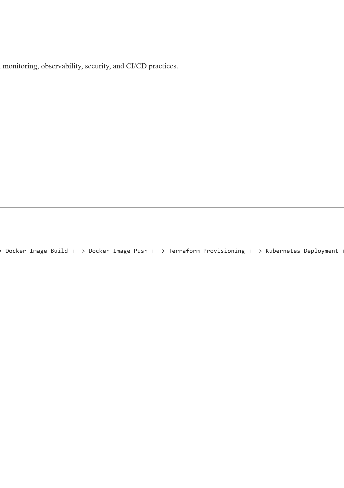

## Run locally
Enterprise Infrastructure Monitoring & Self-Healing Platform
Overview
Enterprise Infrastructure Monitoring & Self-Healing Platform is a DevOps-focused application designed to demonstrate modern infrastructure automation, monitoring, observability, security, and CI/CD practices.

## The platform provides:
Infrastructure health monitoring
System resource monitoring
Process monitoring
Alert generation
Prometheus metrics collection
Grafana dashboard visualization
Automated testing
CI/CD automation
Infrastructure provisioning through Terraform
Kubernetes deployments
Security scanning using Trivy
Code quality validation using SonarQube

## Architecture
Developer
    |
    v
GitHub
    |
    v
GitHub Actions
    |
    v
Jenkins Pipeline
    |
    +--> SonarQube Analysis
    +--> Pytest Validation
    +--> Trivy Security Scan
    +--> Docker Image Build
    +--> Docker Image Push
    +--> Terraform Provisioning
    +--> Kubernetes Deployment
    +--> Health Verification
    +--> Rollback Automation
    |
    v
Amazon EKS
    |
    +--> FastAPI Application
    +--> Prometheus
    +--> AlertManager
    +--> Grafana


```powershell
py -m venv .venv
.\.venv\Scripts\Activate.ps1
python -m pip install -r requirements.txt
uvicorn app.main:app --reload
```

Open `http://127.0.0.1:8000/docs` for the API. Useful endpoints:

| Endpoint | Purpose |
|---|---|
| `/health` | Liveness check |
| `/ready` | Readiness check |
| `/api/v1/system` | CPU, memory, and disk usage |
| `/api/v1/alerts` | Alerts evaluated against configured thresholds |
| `/api/v1/processes` | Active process list |
| `/metrics` | Prometheus metrics |

Set `CPU_ALERT_THRESHOLD` and `MEMORY_ALERT_THRESHOLD` to percentages between
0 and 100. Defaults are 85. The process endpoint exposes host process names and
PIDs, so keep the service on a trusted network.

Run tests with `pytest`.

## Containers
```powershell
docker compose up --build
```

The API listens on port 8000, Prometheus on 9090, and Grafana on 3000. The
compose file uses Grafana's standard local development credentials; do not use
them outside a disposable local environment.

## Kubernetes
Update the image in `kubernetes/deployment.yml` and the hostname in
`kubernetes/ingress.yml` before deploying. Create any required credentials in
your cluster secret store; `kubernetes/secret.yml` intentionally contains no
secret values. Liveness/readiness probes use `/health` and `/ready`.

## Terraform
Terraform provisions an AWS VPC and EKS cluster. Set the required variables,
including an explicit CIDR allowlist for the public EKS API endpoint, in a
local `terraform.tfvars` file that must not be committed. Review estimated AWS
costs before applying; EKS and its worker nodes incur ongoing charges.

## CI/CD
GitHub Actions runs tests and builds the container. The deployment workflow
publishes to GitHub Container Registry; configure a base64-encoded kubeconfig as
the repository secret `KUBE_CONFIG` and update deployment settings before
enabling production deployment. Jenkins provides equivalent test/build stages.